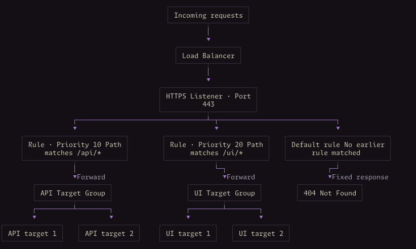

# Fargate Services

## Load Balancer Scenarios

The `FargateServiceV2` component is designed to be used in combination with Load Balancers and progressive deployments. There are several resources that will be mentioned in this guide.

- **Load Balancer**: The Load Balancer that distributes incoming traffic across (potentially) multiple targets
- **Listener**: A process that checks for connection requests using the protocol and port that you configure. The listener receives a request and evaluates it against each rule in priority order.
- **Listener Rule**: Matches requests using conditions and applies actions, such as forwarding to a target group, redirecting, or returning a fixed response.
- **Target Groups**: Route requests to individual registered targets (e.g. EC2 Instances or IPs).



A central concept in the component is the concept of _"attachments"_. An "attachment" is what connects a _listener rule_ to a single container/port running in a Service. This attachment can be very flexible, but if you want to use the progressive deployment strategies offered by ECS (blue/green, linear, canary) then there are some constraints.

From an ownership perspective, the caller or an ALB component owns the listener (its frontend port, certificates, security-group access, and default action). The service attachment creates the forwarding rule, target groups, backend ingress, and ECS deployment configuration.

**Common Configuration for examples below**

```ts
const listener = new aws.lb.Listener('listener', {
  loadBalancerArn: alb.arn,
  port: 80,
  protocol: 'HTTP',
  defaultActions: [
    {
      type: 'fixed-response',
      fixedResponse: {
        contentType: 'text/plain',
        statusCode: '404',
      },
    },
  ],
});

const cluster = new aws.ecs.Cluster('cluster');
const serviceArgs = {
  clusterArn: cluster.arn,
  taskDefinition: task.taskDefinition.arn,
  vpcSubnetIds: vpc.privateSubnetIds,
  deploymentStrategy: {
    canary: {
      canaryPercent: 10,
      canaryBakeTimeMinutes: 10,
      bakeTimeMinutes: 5,
    },
  },
};

const appBackend = {
  containerName: 'app',
  containerPort: 80,
  targetHealthCheck: { path: '/health' },
};
```

This configuration sends 10% of production traffic to the new revision for a 10-minute canary observation period. After the remaining traffic shifts, the separate 5-minute bake time retains the old revision before it is terminated. Application-specific checks or alarms must define what counts as deployment failure.

### How progressive deployments work

Progressive deployments (blue/green, canary, linear) work by provisioning two target groups (`blue` and `green`) per attachment. You attach both target groups to a to a single listener rule with initial weights forwarding 100% of traffic to the `blue` target group.

The component creates a production rule equivalent to the following. This is an illustration of the underlying resources, not an additional rule you need to create.

```ts
new aws.lb.ListenerRule('rule', {
  listenerArn: listener.arn,
  conditions: [{ hostHeader: { values: ['api.example.com'] } }],
  actions: [
    {
      type: 'forward',
      forward: {
        targetGroups: [
          { arn: primaryTargetGroup.arn, weight: 1 },
          { arn: alternateTargetGroup.arn, weight: 0 },
        ],
      },
    },
  ],
});
```

After the initial deployment, the ECS service will manage the weights on the listener rule as part of the progressive deployment. For example, if using a `blue/green` deployment it will change the weight on the `primaryTargetGroup` to `0` and the weight on the `alternateTargetGroup` to `1`.

ECS is only able to do this at this grouping level. You can have multiple `ListenerRule + PrimaryTargetGroup + AlternateTargetGroup` pairings, but the same deployment configuration applies across all of them.

Some things to keep in mind:

- Deployment strategy, canary percentage, and observation periods are configured once for the service and apply to every attachment.
- Each progressive attachment identifies one production listener rule and its primary/alternate target-group pair. Additional rules pointing at those groups do not automatically participate in the deployment.
- All containers in a task belong to the same service revision.
- `blue` and `green` describe the roles of revisions during a deployment, not permanently fixed application versions.
- ALB condition limits, available listener-rule priorities, and ECS target-group limits still apply.
- Rolling deployments create one target group per attachment rather than a pair. Rolling is the default when `deploymentStrategy` is omitted.

### Configuring deployment strategies

Omit `deploymentStrategy` for rolling updates, or select exactly one of `rolling`, `blueGreen`, `canary`, or `linear`. Progressive strategies share the service's deployment configuration across every attachment.

```ts
deploymentStrategy: {
  linear: {
    bakeTimeMinutes: 5,
    stepPercent: 20,
    stepBakeTimeMinutes: 3,
  },
},
```

To send validation requests to the new revision before production shifts, add `testTraffic` to the attachment's application configuration:

```ts
application: {
  listenerArn: listener.arn,
  priority: 50,
  containerName: 'app',
  containerPort: 80,
  testTraffic: {
    match: { headers: [{ name: 'X-Deployment-Test', values: ['true'] }] },
  },
},
```

The test rule uses priority `49` in this example. Production priorities must be greater than 1 when test traffic is configured. Both priorities must be available, including across other attachments on the listener. Test traffic requires a progressive strategy.

ECS owns the forwarding weights after creation. The component ignores changes to those weights so Pulumi does not reset the current traffic allocation. Refresh the stack before subsequent updates to retain ECS's current allocation in state.

Rolling deployments without pause hooks keep the AWS provider's default service timeout. Configured pauses add their timeout budgets to that baseline. Progressive deployments also add the configured traffic-shift and final bake times to the baseline, currently 20 minutes. Set `deploymentTimeout` to override the create and update timeout when needed.

See the AWS [linear configuration](https://docs.aws.amazon.com/AmazonECS/latest/APIReference/API_LinearConfiguration.html) and [infrastructure role](https://docs.aws.amazon.com/AmazonECS/latest/developerguide/AmazonECSInfrastructureRolePolicyForLoadBalancers.html) documentation. The deploying identity needs permission to pass the generated traffic-shift role to ECS.

### Deployment lifecycle hooks

Add `lambdaHooks` or `pauseHooks` inside the selected deployment strategy. Rolling hooks run at `PRE_SCALE_UP`. Progressive hooks specify their lifecycle stages.

```ts
deploymentStrategy: {
  rolling: {
    lambdaHooks: [{
      functionArn: validationFunction.arn,
      hookDetails: {
        endpoint: applicationUrl,
        suites: ['checkout', 'payments'],
      },
    }],
    pauseHooks: [{
      timeoutMinutes: 30,
      timeoutAction: awsxNext.PauseTimeoutAction.ROLLBACK,
    }],
  },
},
```

The Lambda function and any pause hooks at the same stage run in parallel. Every hook must
complete before the deployment proceeds. A Lambda hook returns `hookStatus` of `SUCCEEDED`,
`FAILED`, or `IN_PROGRESS`. ECS reinvokes functions that return `IN_PROGRESS`.

By default, AWSX creates one invocation role shared by hooks without `invocationRoleArn`.
Its policy allows `lambda:InvokeFunction` only on those hooks' function ARNs, preserving
version and alias qualifiers. Supply `invocationRoleArn` to manage the role yourself.
The deploying identity needs permission to pass the role to ECS. Supplied roles must trust
`ecs.amazonaws.com` and allow invocation of their function.

`hookDetails` supports nested objects and Pulumi Outputs. AWSX serializes the resolved map as JSON.
Pass identifiers for secrets, not secret values, and let the function retrieve them using its
own execution role.

Pause hooks wait for an external workflow to call `ContinueServiceDeployment` with the hook ID.
Without a configured timeout, ECS waits 1440 minutes and then rolls back. `CONTINUE` releases only
that pause. Other hooks at the stage must still complete. For canary and linear deployments,
`PRE_PRODUCTION_TRAFFIC_SHIFT` pauses before each traffic shift with a new hook ID.

Pause timeouts are added to the service's timeout budget. Parallel pauses use the longest
timeout per stage. Pauses at different stages are added, and recurring pre-production pauses
are counted for each shift. The current 20-minute baseline and progressive bake budgets are
unchanged. Lambda execution time is unknown, so set `deploymentTimeout` when more time is needed.
Rolling deployments without pauses keep the provider's default timeout.

See AWS documentation for [Lambda hooks](https://docs.aws.amazon.com/AmazonECS/latest/developerguide/lambda-lifecycle-hooks.html)
and [pause hooks](https://docs.aws.amazon.com/AmazonECS/latest/developerguide/pause-lifecycle-hooks.html).

### Single attachment

A single attachment can express all traffic going to the backend service.

- One hostname serving many paths.
- Multiple hostnames route to the same backend
- Several path patterns route to the same backend

For example, an application that serves `/users`, `/orders`, and `/admin` through `api.example.com` can create a single attachment
that matches on hostname and let the backend application handle the URL paths.

```ts
new awsxNext.FargateServiceV2('service', {
  ...serviceArgs,
  loadBalancerAttachments: {
    app: {
      application: {
        containerName: 'app',
        containerPort: 80,
        targetHealthCheck: { path: '/health' },
        listenerArn: listener.arn,
        priority: 50,
        match: {
          hostnames: { values: ['api.example.com'] },
        },
      },
    },
  },
});
```

You could also select only specific paths to send to the backend service.

```ts
match: {
  hostnames: { values: ['api.example.com' ]},
  pathPatterns: { values: ['/api/*', '/admin/*'] },
}
```

This matches requests where the hostname is `api.example.com` **AND** the path matches either `/api/*` **OR** `/admin/*`. Alternatives within a condition are combined with OR, different condition types are combined with AND.

The rule of thumb here is that if you can express the routing logic in a single attachment then you should.

### Multiple attachments to same backend

You can use separate attachments when the same container and port needs more than one independently evaluated production forwarding rule.

- Different priorities, hostname/path pairings, or condition lists that cannot fit in one rule
- Two listeners directly forward application traffic to the same backend
- External and internal clients reach the same application through different load balancers

```ts
new awsxNext.FargateServiceV2('service', {
  ...serviceArgs,
  loadBalancerAttachments: {
    api: {
      application: {
        ...appBackend,
        listenerArn: listener.arn,
        priority: 10,
        match: {
          hostnames: { values: ['api.example.com'] },
          pathPatterns: { values: ['/api/*'] },
        },
      },
    },

    admin: {
      application: {
        ...appBackend,
        listenerArn: listener.arn,
        priority: 20,
        match: {
          hostnames: { values: ['admin.example.com'] },
          pathPatterns: { values: ['/admin/*'] },
        },
      },
    },
  },
});
```

These attachments preserve two specific hostname/path pairings.

- `api.example.com` with `/api/*`
- `admin.example.com` with `/admin/*`

Combining both hostnames and both paths in one rule would also permit the cross-pairings (`api.example.com/admin/*` _and_ `admin.example.com/api/*`). If those pairings must remain distinct, use separate rules and attachments.

For progressive deployments, each production rule has its own primary/alternate target-group pair. Both attachments follow the same service-wide deployment configuration.

#### Different listeners or ALBs

The same pattern works with different `listenerArn` values. For example, maybe you configure a private Load Balancer and a public Load Balancer to route to the same backend. In that case you need two attachments.

> **Automatic ingress limitation:** When attachments share an application or health-check port, automatic ingress requires them to use the same ALB source security group. Different ALBs with different source groups require `manageIngress: false` and user managed task ingress.
>
> AWSX declares ingress resources during preview, when ALB security-group IDs may still be unknown. This restriction avoids duplicate rules without creating resources inside an apply.

```ts
const taskGroup = new aws.ec2.SecurityGroup('task', {
  vpcId: vpc.vpcId,
});
// Configure task egress separately for image pulls and other dependencies.
const privateIngress = new aws.vpc.SecurityGroupIngressRule('task-private', {
  securityGroupId: taskGroup.id,
  referencedSecurityGroupId: privateAlbGroup.id,
  ipProtocol: 'tcp',
  fromPort: 80,
  toPort: 80,
});
const publicIngress = new aws.vpc.SecurityGroupIngressRule('task-public', {
  securityGroupId: taskGroup.id,
  referencedSecurityGroupId: publicAlbGroup.id,
  ipProtocol: 'tcp',
  fromPort: 80,
  toPort: 80,
});
new awsxNext.FargateServiceV2(
  'service',
  {
    ...serviceArgs,
    manageIngress: false,
    securityGroupIds: [taskGroup.id],
    loadBalancerAttachments: {
      public: {
        application: {
          containerName: 'app',
          containerPort: 80,
          listenerArn: publicListener.arn,
          priority: 50,
          match: { pathPatterns: { values: ['/*'] } },
        },
      },
      private: {
        application: {
          containerName: 'app',
          containerPort: 80,
          listenerArn: privateListener.arn,
          priority: 50,
          match: { pathPatterns: { values: ['/*'] } },
        },
      },
    },
  },
  { dependsOn: [privateIngress, publicIngress] },
);
```

If health checks use a separate port, allow that port from both ALB security groups too.

### Multiple attachments to different backends

You can use separate attachments when different containers or ports in a single task receive different traffic.

- A UI container and an API container run together in a single task
- One container serves multiple load-balanced ports

```ts
new awsxNext.FargateServiceV2('service', {
  ...serviceArgs,
  taskDefinition: uiApiTask.taskDefinition.arn,

  loadBalancerAttachments: {
    ui: {
      application: {
        containerName: 'ui',
        containerPort: 3000,
        targetHealthCheck: { path: '/health' },

        listenerArn: listener.arn,
        priority: 10,
        match: {
          hostnames: { values: ['www.example.com'] },
        },
      },
    },

    api: {
      application: {
        containerName: 'api',
        containerPort: 8080,
        targetHealthCheck: { path: '/health' },

        listenerArn: listener.arn,
        priority: 20,
        match: {
          hostnames: { values: ['api.example.com'] },
        },
      },
    },
  },
});
```
